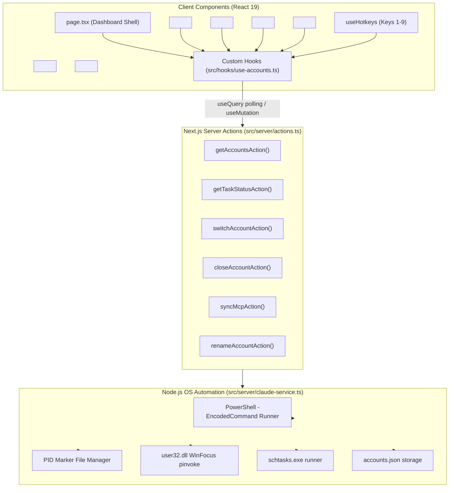

# 🧩 Component Architecture & Data Flow (Server Actions + Custom Hooks)

> Architectural specification for Claude Multi-Deck Next.js 15 application using React 19, Server Actions, TanStack React Query 5, and design-taste-frontend tokens.

---

## Architecture Diagram



---

## Custom Hooks Specification (`src/hooks/use-accounts.ts`)

| Hook | Query / Mutation | Underlying Server Action | Behavior |
| :--- | :--- | :--- | :--- |
| `useAccounts()` | `useQuery` | `getAccountsAction()` | Polls every 2500ms; provides live accounts, running state, PIDs, memory. |
| `useTaskStatus()` | `useQuery` | `getTaskStatusAction()` | Cached for 60s; warns if scheduled tasks aren't registered. |
| `useSwitchAccount()` | `useMutation` | `switchAccountAction({ accountId })` | Optimistically flags account as `isLaunching`; triggers launch or focus; invalidates `accounts`. |
| `useCloseAccount()` | `useMutation` | `closeAccountAction({ accountId })` | Closes active instance; invalidates `accounts`. |
| `useSyncMcp()` | `useMutation` | `syncMcpAction()` | Runs sync script; toasts result. |
| `useRenameAccount()` | `useMutation` | `renameAccountAction({ oldName, newName })` | Updates account name; invalidates `accounts`. |

---

## Design-Taste Tokens & Hierarchy

```css
:root {
  --ground: #121316;          /* Deep obsidian background */
  --surface: #17181d;         /* Base surface panels */
  --raised: #1d1e24;          /* Elevated account cards */
  --border: #27282e;          /* 1px crisp separation */
  --control: #2b2d35;         /* Button / input backgrounds */
  --control-hover: #363842;   /* Hover state */
  --text: #f4f4f6;            /* Primary crisp text */
  --muted: #8a8c92;           /* Secondary labels & metadata */
  --accent: #e06e43;          /* Anthropic Terracotta accent */
  --positive: #44a282;        /* Running process green */
  --positive-bg: #162621;     /* Active pill background */
  --warning: #d9a441;         /* Launching amber */
  --warning-bg: #282315;      /* Launching pill background */
  --negative: #e5566f;        /* Error / close red */
  --negative-bg: #2b171c;     /* Error pill background */
}
```
